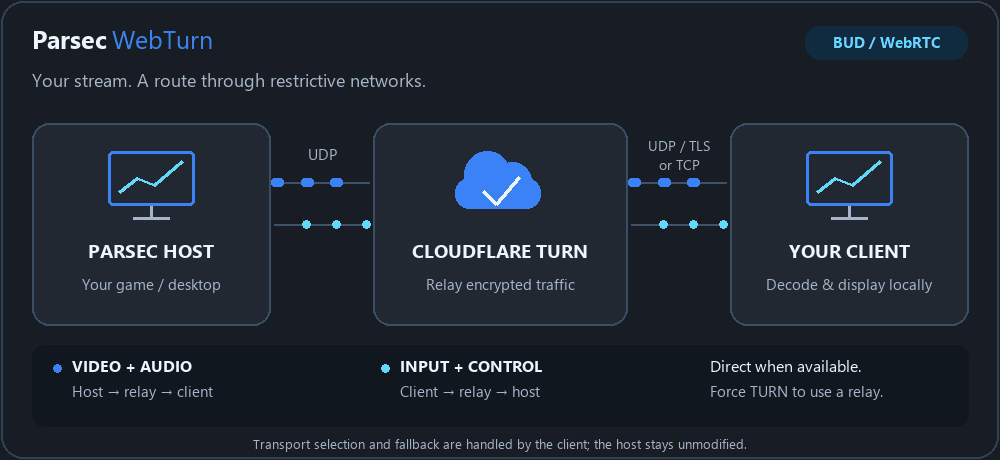

# ParsecWebTurn

**A portable Windows client for connecting to your Parsec computers.**

ParsecWebTurn runs the original, pinned Parsec WebAssembly core in Wasmtime,
with native Rust video, audio, input and networking. No browser, WebView2 or
installer is needed: run **ParsecWebTurn.exe**.

**The Parsec WASM core is unmodified. Rust provides the surrounding runtime and
platform integrations; this is not a rewrite of the proprietary Parsec client.**

[Download v0.9.4](https://github.com/vampywiz17/ParsecWebTurn/releases/tag/v0.9.4)
· [Latest stable release](https://github.com/vampywiz17/ParsecWebTurn/releases/latest)
· [Changelog](CHANGELOG.md)

This README describes the **v0.9.4 stable client** on `main`; `dev` is used for
further development. The earlier WebView2 version remains on the [legacy branch](https://github.com/vampywiz17/ParsecWebTurn/tree/legacy).
For stability-first use, choose **WebRTC with H.264** and leave experimental
options disabled, or use the stable release.

## Getting started

1. Extract the Windows x64 release ZIP and run **ParsecWebTurn.exe**.
2. Sign in, select your host and choose the **web** launch option, including
   when using BUD.
3. Open **Settings** to configure networking, video, audio or input. Save and
   reconnect to apply changes; event logging changes apply immediately.

Requires Windows x64, compatible GPU drivers and D3D11/OpenGL support.
Zero copy additionally requires Windows 11 and driver support. Normal use
requires no administrator rights.

| Shortcut | Action |
| --- | --- |
| F11 | Toggle fullscreen |
| Ctrl+, | Settings |
| Ctrl+Shift+S | Connection stats |
| F8 | Toggle the video layer to reach the underlying interface |

Custom shortcuts in the embedded Hotkeys page take priority.

## Features and settings

The client includes the familiar Parsec overlay, persistent sign-in/preferences,
keyboard/mouse and immersive input, Opus audio, GPU video playback, and two-way
Unicode text clipboard synchronization. Clipboard permissions remain controlled
by the core and host; files and images are not transferred.

### Network

**WebRTC is the default.** Direct connections and custom STUN/TURN are supported,
including Cloudflare credentials and TURN over UDP, TCP or TLS. Enter server URLs
one per line. STUN only excludes TURN; Force TURN relay requires a relay and
cannot be combined with STUN only.

Optional **BUD** uses the same relay settings: direct UDP, then configured TURN
routes preferring **UDP → TLS → TCP** (port 80 first among TCP URLs). Failed initial
attempts try the next relay; established connections are not migrated and BUD
never silently switches to WebRTC. TLS verifies the server certificate and
hostname. TCP/TLS can add head-of-line blocking; the relay-to-host leg stays UDP.
See [BUD TURN transport details](docs/bud-turn-stream.md).

### Video

H.264 is the default. **Prefer H.265 / HEVC** requests HEVC; the host decides the
actual stream. Video GPU selects Automatic or a particular adapter.

| Decoder path | NVIDIA | AMD | Intel |
| --- | --- | --- | --- |
| H.264 | Media Foundation | Media Foundation | Media Foundation |
| HEVC normal, 8-bit | Direct D3D11 | AMF | VPL |
| HEVC Zero copy, 8-bit | Direct D3D11 | Direct D3D11 | Direct D3D11 |

Vendor HEVC and Zero copy have been live-tested on selected GPUs with both
transports, but remain **experimental**. Normal rendering uses a GPU conversion/
scaling pass. **Zero copy** presents the original NV12 decoder surface through
Windows Presentation API, removing that application pass without CPU readback.
This does not prove direct scanout or absence of internal Windows/driver copies.
Unsupported configurations use normal rendering; inspect Connection stats.
Firmware-disabled HEVC, including affected Dell systems, cannot be bypassed by
selecting another decoder.

**10-bit HEVC (experimental)** requests Main 10. The normal Media Foundation path
can output 10-bit RGB SDR without an extra conversion pass, with 8-bit fallback.
Live Main 10 is currently verified only with **NVIDIA host encoding**, including
AMD 780M client decoding; the tested AMD 780M host sent 8-bit instead. Check the
actual profile, decoded depth and RGB output in stats. This is not HDR or proof
of the monitor's physical bit depth. Zero copy currently supports 8-bit only.
See [10-bit output details](docs/rgb10-output.md).

**Display timing (experimental)** offers **Automatic** (default, previous behavior),
**Low latency** and **VSync**. Explicit modes request a one-presentation DXGI queue;
VSync can add delay. Zero copy retains Windows-managed timing. BUD also skips
obsolete display work during backlogs while decoding every reference picture.
Synthetic tests show reduced display work, not a proven live latency gain.
See [timing and measurement scope](docs/local-video-timing.md).

### Audio

- **Custom audio buffer:** optional minimum/maximum limits in milliseconds.
  Initial custom values are **75/150**, matching the pinned core's automatic
  limits. Disabled uses the core's actual limits; enabled requests the shortest
  supported shared WASAPI period with fallback. Lower values can cause gaps.
- **Allow raw PCM audio:** BUD-only, disabled by default. The host must also enable
  `network_raw_audio=1`; otherwise it can send Opus. WebRTC remains Opus.
- **Multichannel audio (experimental, BUD):** optionally request the Windows
  output's 5.1/7.1 layout. The host capture layout must match; stereo is the
  default and fallback. **Validated with synthetic tests only:** live surround,
  channel ordering and audible playback remain unverified. WebRTC stays stereo.

[Audio configuration and limitations](docs/native-audio-options.md)

### Input (experimental)

Optional **USB HID mouse and keyboard** require **BUD** and **USB/Yubikey
passthrough enabled on the stock host**. Select either or both on the Input tab,
save and reconnect. No helper, host modification or extra client installation
is needed.

Mouse input supports desktop positioning, relative camera control, five buttons,
dragging and scrolling on **one physical or virtual display**. Multi-monitor
mapping is unsupported. Keyboard input requires matching active host/client
layouts, such as Hungarian on both; it does not switch the host layout.
Desktop, camera control and simultaneous mouse/keyboard have been live-tested.

Selected HID devices replace ordinary Parsec forwarding, including if setup
fails; disable the option and reconnect to restore normal input. Local menus
remain accessible, and focus loss/disconnect releases held inputs.
See [HID behavior and scope](docs/usb-hid-input.md).

## TURN relay: connect through restrictive networks

TURN forwards encrypted session traffic when NAT or a firewall prevents a direct
connection. The stock Parsec host stays unmodified. The client-to-relay leg can
use UDP, TLS or TCP; the relay-to-host leg uses UDP. Direct connections remain
available unless **Force TURN relay** is enabled.

**A relay does not necessarily mean higher latency.** When the route through
the relay is better than the available direct or VPN route, TURN can deliver
comparable or even lower round-trip time (RTT). This depends on ISP peering,
relay location and congestion; it is not a guaranteed improvement. Compare the
actual routes in **Connection stats**. Cloudflare describes its routing in
[TURN and anycast](https://blog.cloudflare.com/webrtc-turn-using-anycast/).
**No separate VPN, tunnel client, driver or relay helper needs to be installed
on the client PC:** TURN support is built into the application.

**Cloudflare Realtime TURN is our recommended relay.** A free Cloudflare account
is sufficient, including an account already used for Zero Trust Free. TURN is a
separate **Realtime** service: no paid Zero Trust plan or Cloudflare Tunnel is
required.

1. Sign in to the [Cloudflare dashboard](https://dash.cloudflare.com/), select
   your account, and open **Realtime → TURN Server → Create** (or search for
   **TURN Server** in the dashboard).
2. Give the TURN key a name and create it. Copy its **TURN Key ID / Token ID**
   and **API Token** from the resulting credentials panel.
3. In the client's **Settings → Network**, select **Cloudflare TURN**, enter
   the key ID and API token, then save and reconnect. The client generates
   temporary TURN credentials automatically. Enable **Force TURN relay** if you
   want to require the relay; **Connection stats** shows the route actually used.

Keep the API token private; do not attach it or `settings.json` to issues.
See Cloudflare's [setup guide](https://developers.cloudflare.com/realtime/turn/generate-credentials/)
and [dashboard example](https://github.com/cloudflare/speedtest/tree/main/example/turn-worker#creating-a-new-realtime-turn-app).

**Free allowance: 1 TB (1,000 GB) per month**, shared with Realtime SFU.
At a constant average relayed bitrate, this is approximately:

| Average relayed traffic | Hours/month | Hours/day over 30 days |
| --- | ---: | ---: |
| 10 Mbit/s | 222 | 7.4 |
| 20 Mbit/s | 111 | 3.7 |
| 30 Mbit/s | 74 | 2.5 |
| 50 Mbit/s | 44 | 1.5 |

**Video uses a variable bitrate:** with little or no screen movement, such as
mostly static desktop work, it can use much less bandwidth than during active
gameplay. Read the table using the **actual average relayed bitrate**, not the
configured bandwidth limit. Lower average usage makes the allowance last longer;
these figures are estimates, not fixed daily streaming limits.

Estimates use decimal GB and exclude audio/control/protocol overhead, which
reduces the available streaming time. Actual usage varies with the stream;
direct traffic does not consume TURN allowance. Cloudflare meters traffic sent
from its edge to the TURN client. Usage above the shared allowance is currently
**$0.05/GB**; check [current pricing](https://developers.cloudflare.com/realtime/sfu/platform/pricing/)
and the [TURN billing FAQ](https://developers.cloudflare.com/realtime/turn/faq/).

## Statistics and troubleshooting

**Connection stats** shows route, RTT, incoming/outgoing traffic, decoded FPS,
decoder/output format, local drops, audio queues and app CPU/GPU/memory use.
Traffic is usage, not available bandwidth or pure video bitrate; RTT is not ICMP
ping. GPU surfaces indicate a GPU path, not independent proof of hardware decode.

Host video/audio timing is requested automatically while stats is open or event
logging is enabled. Local video timings measure overlapping CPU durations,
**not GPU execution, scanout or end-to-end latency**. Host reports have been
observed live with BUD; WebRTC validation and unusual audio intervals remain open.
The embedded overlay receives native Decode and Network values; its Bitrate
field remains N/A because the core's interface has no bitrate output.

[Host timing](docs/frame-timing-diagnostics.md) ·
[Local video timing](docs/local-video-timing.md) ·
[Overlay metrics](docs/wasm-overlay-metrics.md)

Enable **event logging** in Network settings to write `client-events.jsonl`
beside `settings.json`. It records connection/decoder failures and state changes
with UTC timestamps, without credentials, media, clipboard text or continuous
input events. Logging is off by default, asynchronous and bounded; rotation
retains one previous file. When [reporting a problem](https://github.com/vampywiz17/ParsecWebTurn/issues),
include the version, Windows/GPU/driver, transport, reproduction steps and a log
or screenshot. Never publish settings files, credentials or sign-in tokens.

## Saved data and updates

`settings.json` beside the EXE stores native preferences and Windows-protected
server credentials. Use `--data-dir "C:\YourFolder"` for another writable location.
Sign-in and embedded preferences live under `%LOCALAPPDATA%\ParsecWebTurn\Native`,
protected for your Windows user. Close the app and replace the EXE to update;
keep your settings. Moving from the legacy client requires signing in again.

**Help > Check for updates** offers stable releases only; download dev releases
manually. Updates are never installed automatically. **Help > About** shows the
pinned core and checks the currently served version without replacing it.
`PARSECWEBTURN_NO_UPDATE_CHECK=1` disables background update/core-version checks.

## Status and roadmap

BUD, custom audio buffering, raw PCM permission and host timing are included
without an experimental label in **v0.9.4**. Vendor HEVC, Zero copy, 10-bit HEVC,
display timing, multichannel audio and USB HID input remain experimental, with
the validation limits above.

The maintainer completed Intel/AMD/NVIDIA video testing before this stable
release. Results apply to supported combinations actually tested; the capability
requirements and specific validation limits above still apply.

HID mouse/keyboard are implemented; gamepad verification and further native menu
integration remain pending. Vulkan/Linux are planned; D3D12 and Android/Android TV
are exploratory, without delivery dates. HDR and 4:4:4 are not implemented.
Not every setting in the embedded interface has a native implementation.

## Legal notice and original Parsec code

**This project was developed without access to Parsec's proprietary source code.
No proprietary Parsec source code has been edited or incorporated into the Rust
implementation. The original Parsec WASM binary is unmodified.**

The publicly served, closed-source WASM binary is pinned, SHA-256 verified and
precompiled for Wasmtime, then included in the application. Precompilation does
not patch the WASM. Rust supplies the native framework, not a rewritten Parsec
core; the lowlat-based BUD adapter is a separate implementation.

The MIT license covers this project's own code, not the proprietary component.
Third-party licenses and applicable terms still apply; integrity checks do not
grant redistribution permission. Included license notices must accompany binaries.
ParsecWebTurn is independent and is not affiliated with or endorsed by Parsec or
Unity. Names and marks belong to their respective owners.

## Acknowledgements: lowlat

Thanks to Duy (Nguyen Duy) and [lowlat](https://github.com/nomi-san/lowlat) for
inspiration, open-source components and technical feedback. ParsecWebTurn adapts
selected MIT-licensed lowlat code for BUD, TURN and vendor GPU backends, retaining
licenses and attribution. See the backend notices and
[research references](docs/NATIVE_REFERENCES.md).

**ParsecWebTurn is independently developed and maintained, not part of lowlat or
an official lowlat client.** Code reuse does not imply affiliation or endorsement.

## Build and contribute

Build on Windows with Rust MSVC and C++ build tools: `./scripts/build.ps1`.
Application code and backend crates are under `src-native`; diagnostic tools
require the separate opt-in `diagnostics` build feature.

[Technical guide](docs/NATIVE_TECHNICAL.md) ·
[Configuration compatibility](docs/NATIVE_CONFIG_COMPATIBILITY.md) ·
[Research references](docs/NATIVE_REFERENCES.md)
